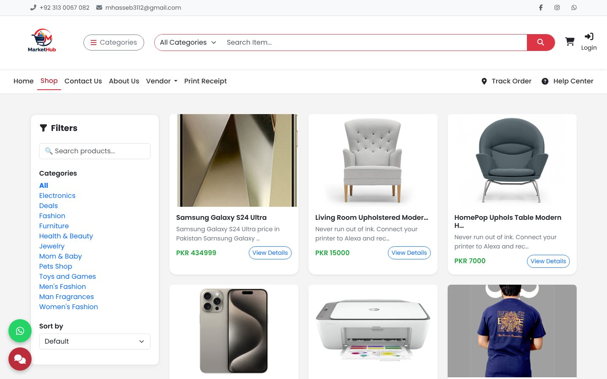
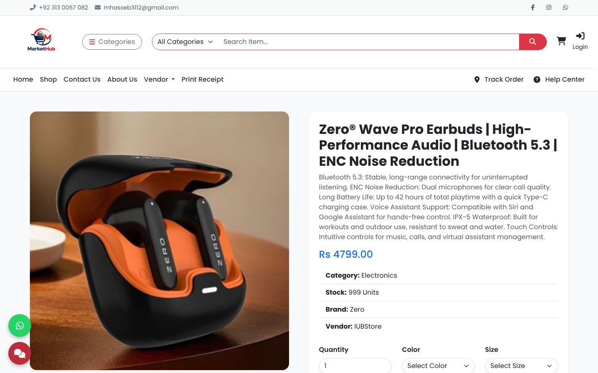
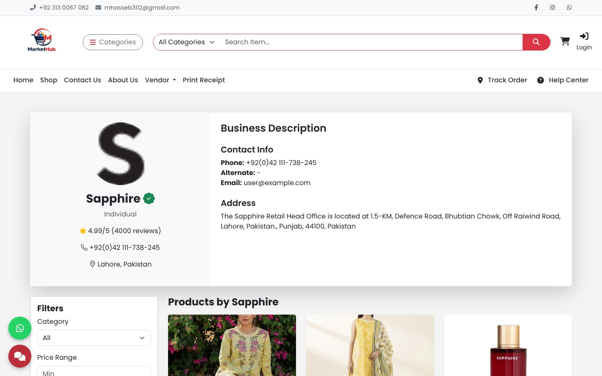
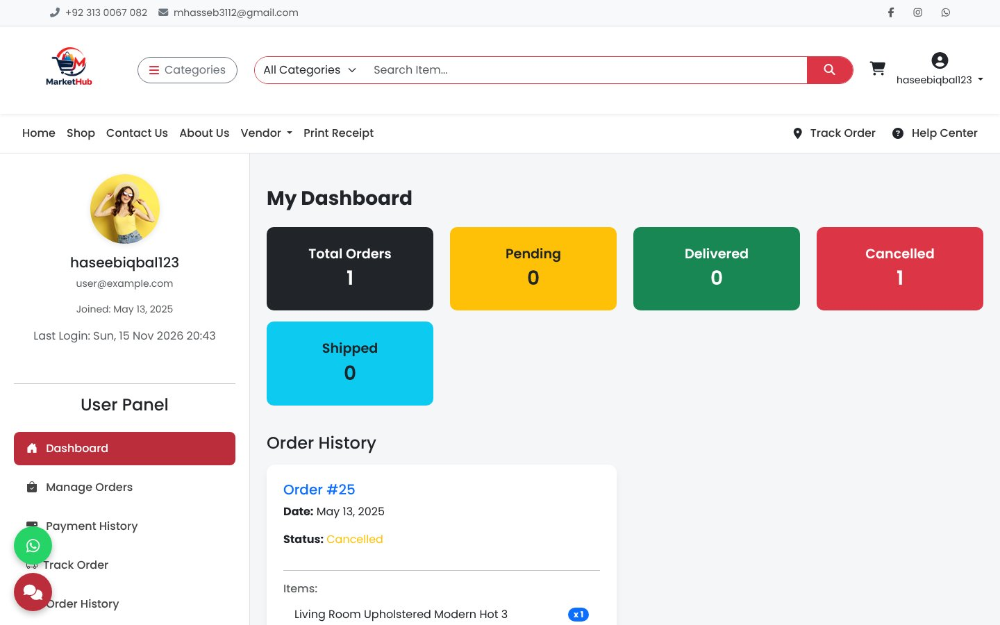
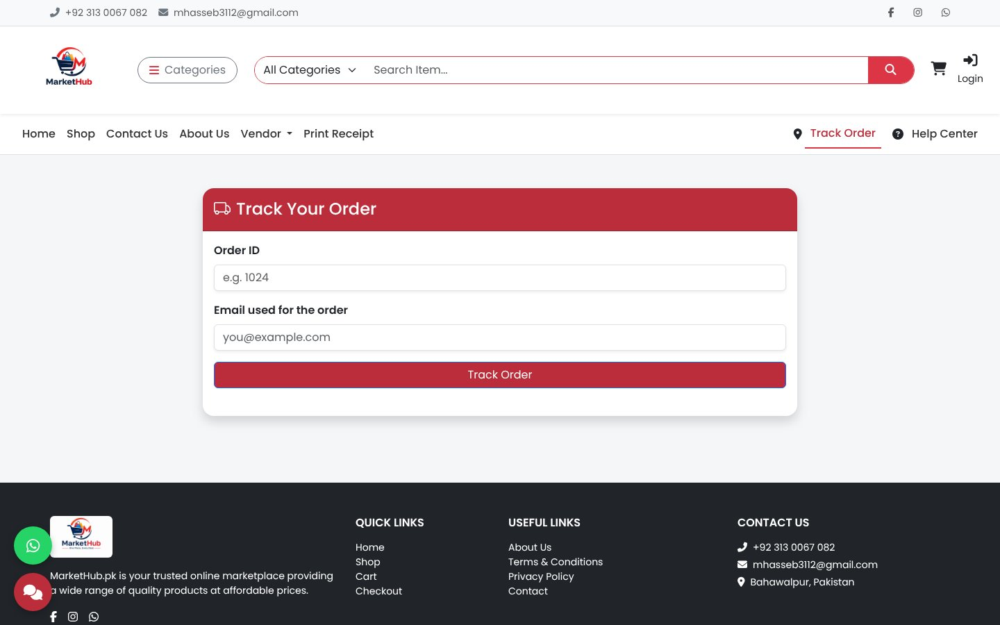
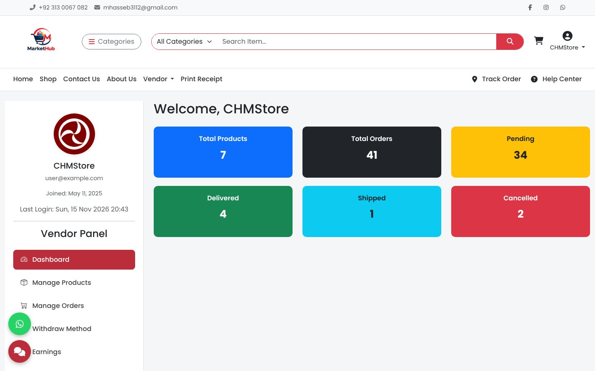
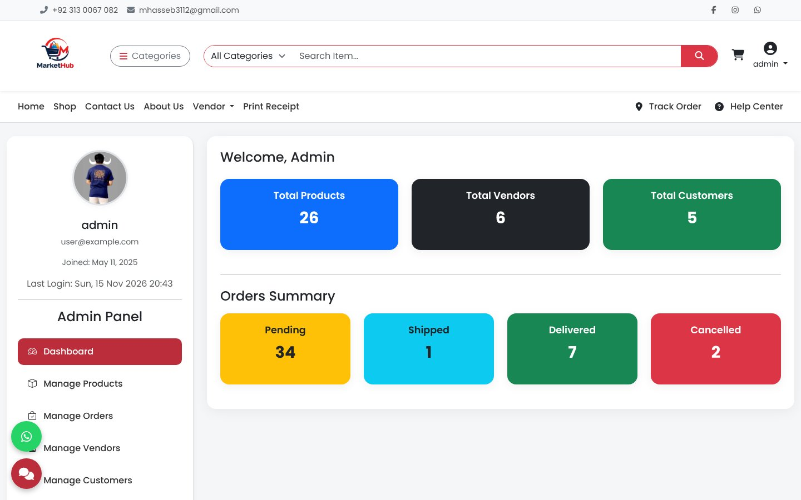
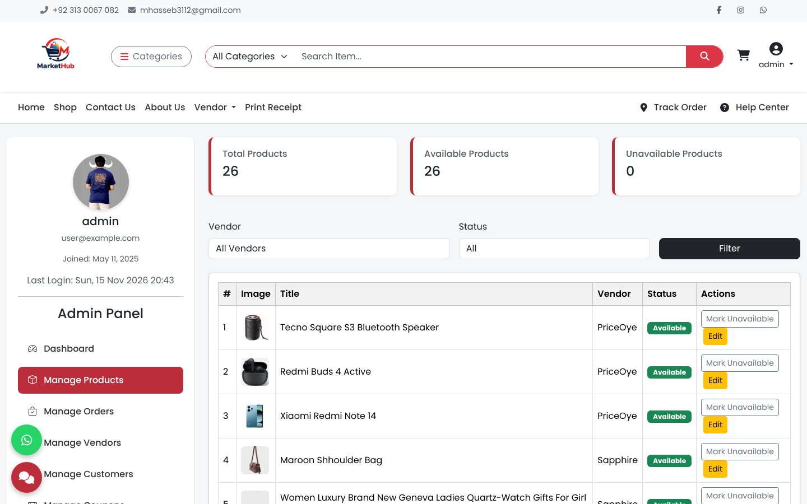
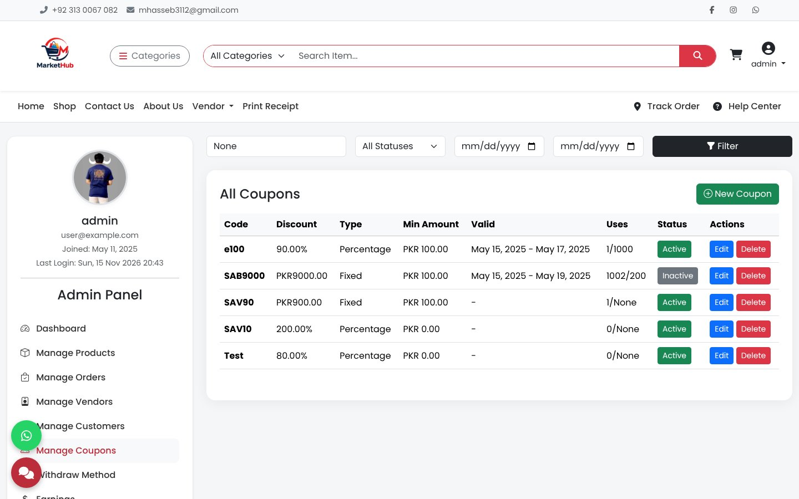

# 🛒 MarketHub - Multi-Vendor Ecommerce Platform

> A complete Multi-Vendor Ecommerce Platform developed using Django, enabling customers, vendors, and administrators to interact through a secure, scalable, and feature-rich online marketplace.


---

# 📖 Overview

MarketHub is a comprehensive Multi-Vendor Ecommerce Platform built with Django.

The platform allows multiple vendors to register and manage their own online stores while customers can browse products, place orders, track deliveries, review products, and securely complete purchases.

The system includes dedicated dashboards for:

- Customers
- Vendors
- Administrators

along with secure authentication, order management, payment handling, coupon management, vendor withdrawals, email notifications, QR/Barcode receipt generation, and much more.

---

# ✨ Key Features

## 👤 Customer Module

- Customer Registration
- Email Verification
- Secure Login
- Password Reset
- Profile Management
- Browse Products
- Search Products
- Category Filtering
- Shopping Cart
- Apply Coupons
- Checkout
- Order Confirmation
- Order Tracking
- Order History
- Payment History
- Product Reviews
- Product Ratings
- Product Questions
- Reorder Previous Orders

---

## 🏪 Vendor Module

- Vendor Registration
- Vendor Dashboard
- Product Management
- Product Variants
- Inventory Management
- Stock Updates
- Manage Customer Orders
- Shipping Updates
- Earnings Dashboard
- Withdrawal Requests
- Payment Details
- Vendor Store
- Vendor Profile Management

---

## 🛠 Admin Module

- Admin Dashboard
- Product Management
- Vendor Management
- Customer Management
- Coupon Management
- Order Management
- Withdrawal Management
- Vendor Payment Verification
- CSV Export
- PDF Export
- Payment Monitoring

---

## 🛍 Shopping Features

- Product Categories
- Featured Products
- Related Products
- Product Variants
- Color Variants
- Size Variants
- AJAX Product Filtering
- Product Quick View
- Search Functionality
- Pagination
- Wishlist Ready Architecture

---

## 💳 Checkout & Payment

- Complete Checkout System
- Billing Information Validation
- Card Validation (demo checkout: no real payment gateway is charged)
- Visa & MasterCard Support
- Payment Records
- Secure Order Creation
- Automatic Cart Clearing
- Order Confirmation Email

---

## 📦 Order Management

- Order History
- Order Details
- Order Tracking
- Shipping Status
- Courier Information
- Tracking Number
- Estimated Delivery
- QR Code Receipt
- Barcode Receipt

---

## 💰 Vendor Earnings

- Automatic Earnings Calculation
- Available Balance
- Withdrawal Requests
- Withdrawal Approval Workflow
- Vendor Payment Verification
- Withdrawal History

---

## 🎟 Coupon System

- Coupon Creation
- Coupon Expiry
- Active/Inactive Coupons
- Usage Limits
- Customer Validation
- Discount Calculation

---

## 📧 Email Notifications

The system automatically sends emails for:

- Account Verification
- Password Reset
- Password Change
- Order Confirmation
- Contact Form
- Withdrawal Approval
- Withdrawal Rejection
- Vendor Notifications

---

# 🏗 System Architecture

```
                 +------------------+
                 |     Customer     |
                 +------------------+
                          |
                          |
                 Django Authentication
                          |
          --------------------------------
          |              |               |
          |              |               |
      Customer        Vendor         Administrator
      Dashboard      Dashboard        Dashboard
          |              |               |
          |              |               |
     Shopping      Product CRUD     System Control
          |              |               |
          --------------------------------
                    Django ORM
                         |
            PostgreSQL (Docker) / SQLite (local dev)
```

---

# 🛠 Technology Stack

## Backend

- Python
- Django
- Django ORM

## Frontend

- HTML5
- CSS3
- Bootstrap 5
- JavaScript
- AJAX

## Database

- PostgreSQL 16 (Docker / production)
- SQLite (zero-config local development)

## DevOps

- Docker & Docker Compose
- Gunicorn
- WhiteNoise (static files)

## Email

- SMTP Email Backend

## Libraries

- qrcode
- python-barcode
- Pillow
- ReportLab

---

# 📂 Project Structure

```
MarketHub/
│
├── api/
│   ├── admin.py
│   ├── adminviews.py
│   ├── authviews.py
│   ├── cartviews.py
│   ├── checkoutviews.py
│   ├── contactviews.py
│   ├── paymentviews.py
│   ├── ratelimit.py
│   ├── tracking.py
│   ├── withdrawviews.py
│   ├── tests.py
│   ├── productsviews.py
│   ├── shopviews.py
│   ├── userdashviews.py
│   ├── vendorviews.py
│   ├── views.py
│   ├── urls.py
│   ├── forms.py
│   ├── models.py
│   └── signals.py
│
├── templates/
│   ├── admin/
│   ├── auth/
│   ├── customers/
│   ├── vendor/
│   ├── purchase/
│   ├── products/
│   ├── partials/
│   ├── emails/
│   └── includes/
│
├── deploy/                 (production compose + guide)
├── docker/entrypoint.sh
├── docs/screenshots/
├── media/
├── static/
├── Dockerfile
├── docker-compose.yml
├── .env.example
├── manage.py
└── requirements.txt
```

---

# 📊 Modules

- Authentication
- Product Management
- Vendor Management
- Customer Management
- Shopping Cart
- Checkout
- Payment
- Coupons
- Reviews
- Ratings
- Product Questions
- Order Tracking
- Vendor Earnings
- Withdrawals
- QR Receipt
- Barcode Receipt
- Email System
- Contact System

---

# 🔒 Security Features

- Django Authentication
- Login Required Views
- Admin Authorization
- Vendor Authorization
- Form Validation
- CSRF Protection
- Email Verification
- Password Encryption
- Card data minimisation: only the last 4 digits are stored, CVV is never saved
- Ownership checks on orders, receipts and vendor order pages
- Destructive actions (deletes, approvals) accept POST only
- Order tracking requires Order ID + order email
- Atomic checkout and race-safe stock updates
- Login rate limiting: 5 failed attempts lock the form for 15 minutes
- Vendor documents restricted to PDF / JPG / PNG uploads
- Secrets loaded from environment variables (`.env`, never committed)
- Session Based Cart

---

# 📷 Screenshots

| Home | Shop |
|---|---|
|  |  |

| Product Details | Vendor Store |
|---|---|
|  |  |

| Customer Dashboard | Order Tracking |
|---|---|
|  |  |

| Vendor Dashboard | Admin Dashboard |
|---|---|
|  |  |

| Admin: Products | Admin: Coupons |
|---|---|
|  |  |

---

# 🚀 Installation

## Option 1: Docker (PostgreSQL), recommended

```bash
git clone https://github.com/MuhammadHaseeb3112/Multi-Vendor-Ecommerce-Platform.git
cd Multi-Vendor-Ecommerce-Platform

cp .env.example .env        # then set SECRET_KEY and POSTGRES_PASSWORD
docker compose up -d --build
docker compose exec web python manage.py createsuperuser
```

Open http://localhost:8000/

The `web` container runs migrations and `collectstatic` on start, then serves the app with Gunicorn. Data lives in the `postgres_data` and `media_data` volumes.

Generate a secret key:

```bash
python -c "import secrets; print(secrets.token_urlsafe(50))"
```

---

## Option 2: Local development (SQLite)

```bash
python -m venv venv
venv\Scripts\activate          # Windows
source venv/bin/activate       # Linux / Mac

pip install -r requirements.txt
cp .env.example .env           # set DEBUG=True and leave POSTGRES_DB empty
python manage.py migrate
python manage.py createsuperuser
python manage.py runserver
```

Leave `POSTGRES_DB` empty to use SQLite; set it to use PostgreSQL.

---

## Demo data

Want something to click through straight away? Load the demo data set
(demo logins, 5 stores, 26 products, 30 sample orders, no real customer data):

```bash
python manage.py seed_demo --force            # local
docker compose exec web python manage.py seed_demo --force   # Docker
```

Logins: `demo_customer`, `demo_vendor`, `demo_admin`, password `DemoPass123!`.

Setting `DEMO_MODE=True` turns the app into a safe public demo:

- **Customer** and **Vendor** on the login page create a private sandbox
  account. A vendor gets their own copy of a store (products, orders,
  earnings) to manage freely; nothing they do is visible to other visitors
  (per-request sandbox filtering in `api/sandbox.py`).
- **Admin** is a read-only view of the whole marketplace.
- No email is sent; sign-ups and reviews are off; data resets nightly.
Deployment behind a reverse proxy is described in [deploy/DEPLOY.md](deploy/DEPLOY.md).

---

## Run Tests

42 automated tests cover access control, order tracking, payment data handling, cart and coupon flows, stock updates, login rate limiting and demo mode.

```bash
python manage.py test api
# or inside Docker
docker compose exec web python manage.py test api
```

---

# 📈 Future Enhancements

- Stripe Integration
- JazzCash Integration
- EasyPaisa Integration
- PayPal
- Product Recommendations
- AI Chatbot
- Sales Analytics
- REST API
- Mobile App
- Real-Time Notifications
- Multi-language Support
- CI pipeline (GitHub Actions)

---

# 👨‍💻 Developer

**Muhammad Haseeb**

Software Developer

📧 mhasseb3112@gmail.com

📍 Lahore, Pakistan

GitHub:
https://github.com/MuhammadHaseeb3112

LinkedIn:
https://www.linkedin.com/in/codewithmuhammadhaseeb/

---

# 📄 License

This project is shared for learning and portfolio purposes.

---

# ⭐ Acknowledgements

Special thanks to:

- Django Documentation
- Bootstrap
- Python Community
- Stack Overflow
- Open Source Contributors

---

## ⭐ If you found this project useful, don't forget to star the repository.
